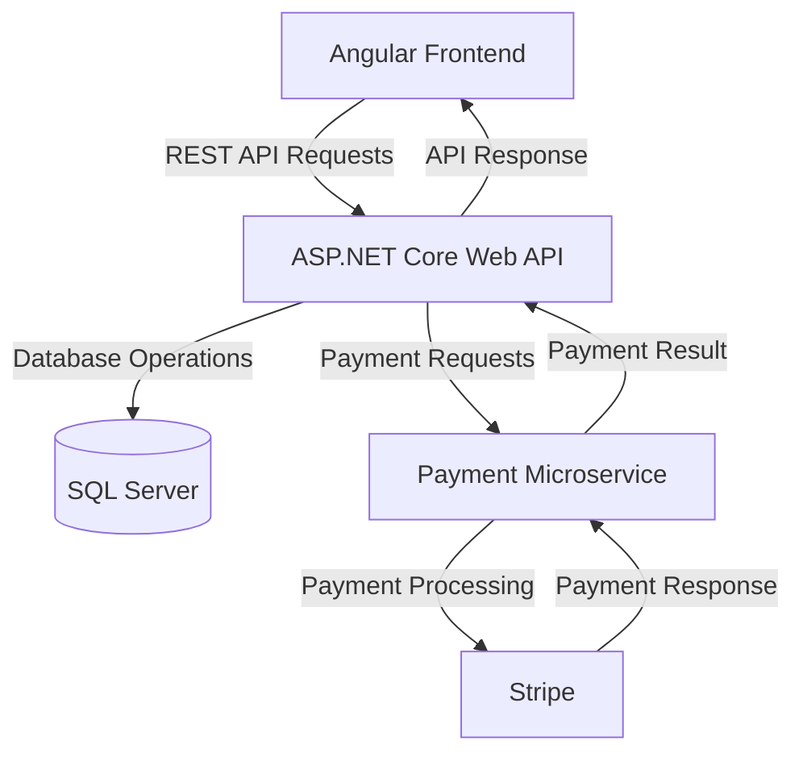

# On-Demand Car Wash System

## Project Overview

The **On-Demand Car Wash System** is a full-stack web application that allows customers to book car washing services online. Customers can register, log in, explore available washing packages, schedule bookings, and make payments through Stripe integration.

The application is developed using Angular and ASP.NET Core Web API, with a separate payment microservice to handle payment processing.

## Key Features

### Customer
- Customer registration and login.
- Browse available car wash packages.
- Book car washing services.
- View booking details and status.
- Make payments through Stripe integration.
- Access payment confirmation.

### Admin
- Manage customer bookings.
- Review and accept booking requests.
- Manage booking statuses.

### Washer
- Access washer-related functionality.
- View assigned booking information and history.

### Payment Integration
- Separate ASP.NET Core payment microservice.
- Stripe integration for payment processing.
- Communication between the main API and payment service.

## Technology Stack

| Layer | Technologies |
|---|---|
| Frontend | Angular, TypeScript, HTML, CSS |
| Backend | ASP.NET Core Web API, C# |
| Database | SQL Server, Entity Framework Core |
| Authentication | JWT Authentication |
| Payment | Stripe |
| Architecture | Full-stack application with a separate payment microservice |
| Version Control | Git and GitHub |

## System Architecture

The application consists of three main application components:

1. **Angular Frontend:** Provides the user interface for customers, admins, and washers.
2. **ASP.NET Core Web API:** Handles business logic, authentication, booking operations, and database interactions.
3. **Payment Microservice:** Handles payment-related operations through Stripe integration.



## Application Workflows

### Customer Booking Flow

1. Customer registers or logs in.
2. Customer browses available car wash packages.
3. Customer selects a package and submits a booking.
4. Booking information is stored in SQL Server.
5. The booking initially receives a Pending status.
6. Admin reviews and accepts the booking.
7. The booking status is updated accordingly.

### Payment Flow

1. Customer initiates the payment process.
2. The Angular frontend communicates with the main ASP.NET Core API.
3. The main API communicates with the separate Payment Microservice.
4. The Payment Microservice integrates with Stripe to process the payment.
5. The payment result is returned through the services to the application.
6. The frontend displays the payment result.

## Project Repository

[View Source Code on GitHub](https://github.com/Tanveeborse/On-Demand-Car-Wash-System)


## Prerequisites

Before running the application, install:

- .NET 8 SDK
- Node.js and npm
- Angular CLI 19
- SQL Server LocalDB
- Visual Studio or Visual Studio Code
- A Stripe account for payment integration

## Installation and Setup

### 1. Clone the Repository

```bash
git clone https://github.com/Tanveeborse/On-Demand-Car-Wash-System.git
cd On-Demand-Car-Wash-System
```

### 2. Configure the Database

- Ensure SQL Server LocalDB is installed and running.
- Configure the SQL Server connection string in the application configuration.
- The default development configuration uses a local database named `GreenWashDb`.
- Apply the Entity Framework Core migrations if the database has not already been created.

### 3. Configure Application Secrets

Configure the required JWT and Stripe settings using .NET User Secrets or environment variables.

Required configuration includes:

- Main API: `JWT:Key`
- Payment Service: `Stripe:SecretKey`
- Payment Service: `Stripe:PublishableKey`

**Important:** Never commit actual API keys, JWT secrets, passwords, or other sensitive credentials to GitHub.

### 4. Run the Main API

Open a terminal:

```bash
cd GreenWashAPI/GreenWashAPI
dotnet restore
dotnet run
```

### 5. Run the Payment Microservice

Open another terminal:

```bash
cd GreenWashAPI/PaymentServices
dotnet restore
dotnet run
```

Ensure the Payment Service URL configured in the main API matches the URL where the Payment Service is running.

### 6. Run the Angular Frontend

Open another terminal:

```bash
cd GreenCarWashUI
npm install
npm start
```

Open the Angular application in your browser at:

http://localhost:4200

**Note:** Update local API and payment service URLs if your launch settings use different ports.